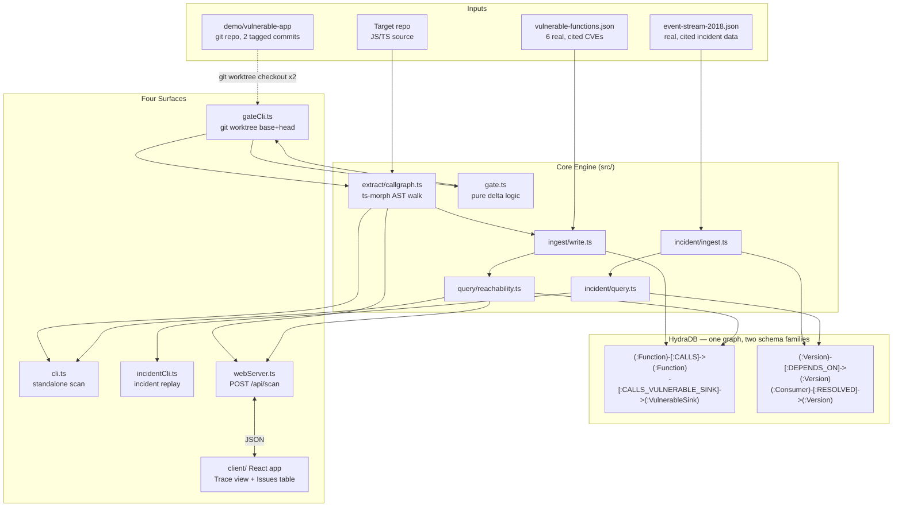
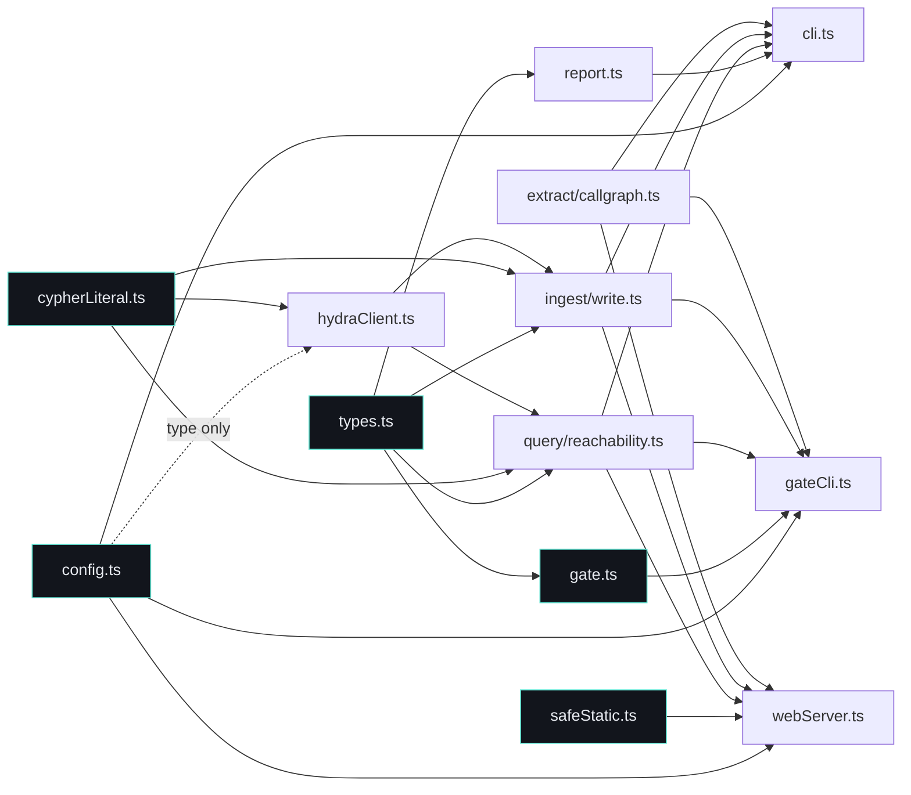

# hydra-triage — Technical Reference

This is not the pitch. `README.md` is the pitch — what the product is,
why it needed HydraDB, how to run it. This document is everything
underneath that: the system architecture (as diagrams, not just prose),
every module, every bug that got found and fixed, every design decision
and why it was made that way instead of some other way, the complete
self-test inventory, and an exhaustive account of what's actually been
verified versus what's been carefully written but never executed. If
`README.md` is what you show a judge, this is what you hand an engineer
doing due diligence, or what you read yourself at 2am before the
deadline to remember why something is the way it is.

Numbers as of the last full self-test run: **34 TypeScript/TSX/MJS
source files** (excluding generated build output), **~2,930 lines**
across them, **48 self-test assertions passing** (37 at the project root,
11 in the separate `client/` npm project). Every number in this document
was re-verified by actually running something, not recalled from memory.

**On the diagrams below:** this sandbox can't render Mermaid — there's no
browser and no Mermaid CLI available. Every diagram was checked
programmatically for bracket balance and scanned for the specific syntax
patterns known to break Mermaid parsers (unquoted labels containing `(`
or `:`, malformed dotted-edge label syntax — one instance of the latter
was actually found and fixed this way), but none has been visually
confirmed to render correctly. Same honesty boundary as everything else
in this document: checked as rigorously as this sandbox allows, not
verified beyond that.

### System architecture — four surfaces, one core engine, shared HydraDB



**What this diagram is actually claiming:** there is one core engine
(extraction → ingestion → reachability query) reused, unmodified, by
three of the four surfaces — the standalone CLI, the PR gate, and the web
server. The incident-replay module uses a different schema (`Version`/
`Consumer`, not `Function`/`VulnerableSink`) but lives in the same
HydraDB graph and the same codebase, sharing the HTTP client and the
Cypher-literal serializer. The React client never touches HydraDB
directly — it only ever talks to `webServer.ts` over `POST /api/scan`,
which is why the client and the CLI can't silently disagree with each
other: they're driven by the exact same function calls, not two
independent implementations of the same idea.

---

## Part 1 — Why this project's shape is the way it is

### 1.1 The starting brief and the four pivots

The brief (Hack Hydra, Track 02 — "Repos, dependencies + code as
graphs") asked for something demonstrating chained-vulnerability
discovery or dependency-graph modeling over HydraDB. The project went
through four distinct framings before landing on its current shape, and
the reasoning for each pivot is worth recording because it's the actual
argument for why the current version is defensible, not just the latest
guess:

1. **Generic reachability analysis** (v1). Parse a JS/TS repo's call
   graph, flag which CVEs in the dependency tree are actually reachable
   from an entry point versus just present. Rejected as the sole pitch
   because this is a mature commercial category — Endor Labs, Socket,
   Semgrep Supply Chain all sell exactly this. Not novel enough on its
   own to win a hackathon judged partly on originality.
2. **Real incident replay** (v2, additive). Reproduce the 2018
   event-stream/flatmap-stream/Copay supply-chain attack against real,
   cited facts (§4 below), specifically because it demonstrates a genuine
   graph-plus-property-filter argument the generic version didn't have:
   reachability alone flags everyone who had the malicious code; a
   property filter on the consuming application (`packageDescription ===
   "A Secure Bitcoin Wallet"`) finds the one application it was actually
   built to harm. This survived into the final version as §14 of
   `README.md`.
3. **PR gate** (v3, the actual pivot). The critique that stuck: a
   one-shot batch scan barely uses what a *persistent* graph database is
   for, and the demo's climax ("4 exposed, 1 targeted") was
   intellectually correct but quiet — not a moment that makes a judge sit
   up. The fix: reframe the product as a merge gate that keeps a graph
   incrementally updated commit-by-commit and blocks a PR based on a
   **delta** query, not a snapshot. This is the current headline (§15 of
   `README.md`), demonstrated against two real git commits in
   `demo/vulnerable-app` (`pre-pr` → `pr-482`).
4. **React client rebuild** (v4, presentation layer only). The original
   browser client was a single hand-written HTML file with
   string-concatenated markup and vanilla DOM manipulation — explicitly
   called out as not senior-level engineering, correctly. Rebuilt from
   scratch as a real Vite + React + TypeScript project with component
   boundaries and a logic layer (`issuesLogic.ts`) deliberately kept free
   of React so it's independently testable.

None of the earlier framings were deleted outright — the reachability
engine, the incident replay, and the PR gate all still exist and are all
still real, running code. Each pivot was additive or a reframing of
emphasis, not a rewrite from zero, which is why the project has four
distinct demo-able surfaces instead of one thin one.

### 1.2 The standing sandbox constraint

Every design decision in this project has to be read against one fact:
**this sandbox has no network access in the bash tool.** No `npm
install`, no `git clone` of HydraDB, no live socket to a running HydraDB
node, ever, at any point in this project's construction. (Separately, the
`web_search`/`web_fetch` tools *do* have network access — that's how §4's
incident facts and the Docker image verification in §6.3 were sourced.
But nothing executable — no package manager, no compiler with real
dependencies, no live database connection — has ever run in this
sandbox.)

This constraint shaped almost every methodological choice below:

- **Node's native `stripTypeScriptTypes`** (`node:module`, experimental
  as of Node 22) became the substitute for `tsc`: it strips TypeScript
  type annotations without needing the `typescript` npm package
  installed, so plain-TypeScript (non-JSX) files could actually execute
  in this sandbox, not just be read for syntax errors.
- **In-memory HydraDB stand-ins** (three of them — see §5.4) became the
  substitute for a real HydraDB node: hand-written HTTP servers that
  parse the *actual* Cypher-literal text the client code generates and
  answer with real graph traversal (BFS), not canned responses.
- **JSX remained fundamentally untestable.** `stripTypeScriptTypes`
  explicitly does not support JSX — it's not erasable-only syntax, it
  needs real codegen. This is the one category of code in the entire
  project that has never been executed in any form, not even a parse
  check. Every `.tsx` file is reviewed-by-eye only. This is stated
  plainly in three places (`README.md` §10.6, `RUNBOOK.md` Step 6, and
  here) rather than left implicit.

---

## Part 2 — Complete module inventory

### 2.0 Module dependency graph — `src/`



Highlighted nodes (`types.ts`, `cypherLiteral.ts`, `config.ts`,
`safeStatic.ts`, `gate.ts`) are the five modules with **zero external
dependencies** — no `ts-morph`, no live HydraDB socket, nothing this
sandbox couldn't run. That's not incidental: it's why 37 of the 48
self-test assertions exist at all. Everything downstream of `extract/callgraph.ts`
(shown flowing into `cli.ts`, `gateCli.ts`, `webServer.ts`) is the part
that's never actually executed in this sandbox — see Part 3.7.

### 2.1 Core reachability engine (`src/`)

| File | Lines (approx) | Purpose | Depends on |
|---|---|---|---|
| `types.ts` | 60 | Every shared interface: `FunctionNode`, `CallEdge`, `CallGraph`, `VulnerableFunctionEntry`, `ReachabilityResult` | none |
| `cypherLiteral.ts` | 55 | Renders JS values as real Cypher literal syntax (bare identifier map keys, escaped strings) | none |
| `config.ts` | 20 | Single source of truth for HydraDB connection settings (baseUrl/token/namespace/graph/cell), override > env > default precedence | `hydraClient.ts` (type only) |
| `safeStatic.ts` | 30 | Path-containment check for serving `client/dist/`, using `path.relative` not a prefix check | none |
| `hydraClient.ts` | 65 | HTTP client for HydraDB's `/v1/graphs/{graph}/query` endpoint, with `AbortController`-based timeout | `cypherLiteral.ts` |
| `extract/callgraph.ts` | 230 | ts-morph-based call graph extraction: ESM + CJS `require()`, entry-point classification, nearest-enclosing-function call attribution | `ts-morph` (external) |
| `vulndb/vulnerable-functions.json` | — (data) | 6 real, cited CVEs mapped to their specific vulnerable exported function | — |
| `ingest/write.ts` | 90 | Writes `CallGraph` + vulndb into HydraDB; returns the set of `VulnerableSink` ids that got a real `CALLS_VULNERABLE_SINK` edge | `hydraClient.ts`, `cypherLiteral.ts` |
| `query/reachability.ts` | 85 | The actual triage decision: bounded-path `MATCH` per CVE, three-way classification (`reachable` / `present-unreachable` / `not-present`) | `hydraClient.ts`, `cypherLiteral.ts` |
| `report.ts` | 100 | Console table + standalone HTML report renderer | `types.ts` |
| `cli.ts` | 65 | Standalone CLI entry point, orchestrates extract → ingest → query → report | everything above |
| `webServer.ts` | 90 | HTTP wrapper exposing the identical pipeline as `POST /api/scan`, serves `client/dist/` | everything above, `safeStatic.ts` |
| `gate.ts` | 70 | Pure delta logic: base scan + head scan → newly-reachable / newly-clear / unchanged | `types.ts` only |
| `gateCli.ts` | 130 | PR gate CLI: `git worktree` checkout of two refs, runs the pipeline against each, diffs via `gate.ts` | everything above, `node:child_process` |
| `incident/event-stream-2018.json` | — (data) | Real, cited 2018 event-stream/flatmap-stream/Copay incident data, timeline, sources | — |
| `incident/ingest.ts` | 100 | Loads the incident graph (`Version`/`Consumer`/`DEPENDS_ON`/`RESOLVED`), including 3 explicitly-labeled synthetic decoy consumers | `hydraClient.ts`, `cypherLiteral.ts` |
| `incident/query.ts` | 45 | The exposure-vs-actually-targeted query pair | `hydraClient.ts`, `cypherLiteral.ts` |
| `incidentCli.ts` | 55 | Runs the incident replay end to end, prints the contrast | everything above |

### 2.2 React client (`client/`)

A fully separate npm project (own `package.json`, own `node_modules`,
own build), talking to `webServer.ts` purely over `POST /api/scan`.

| File | Purpose |
|---|---|
| `src/types.ts` | Client-side mirror of the server's `ReachabilityResult` shape |
| `src/api.ts` | Two-function fetch wrapper |
| `src/issuesLogic.ts` | Pure filter/search/sort logic for the Issues tab — deliberately zero React, zero DOM |
| `src/App.tsx` | Owns scan state (`stats`, `findings`, `scanning`, `statusText`/`statusKind`) and tab switching |
| `src/components/TopBar.tsx` | Repo path input, Scan/Reset buttons, status pill |
| `src/components/StatRail.tsx` | Left-rail extraction/triage stat counts and legend |
| `src/components/TraceView.tsx` | The animated trace lanes — one `useEffect` staggers the `traced` CSS class onto each lane sequentially |
| `src/components/IssuesTable.tsx` | Renders whatever `issuesLogic.ts` returns; owns only expand/collapse and controlled-input state |
| `src/index.css` | All styling — dark console aesthetic, CSS custom properties for the palette |
| `vite.config.ts` | Dev-server proxy (`/api` → `webServer.ts` on :5173) and build output config |

### 2.3 Demo target (`demo/vulnerable-app/`)

A synthetic Express app, its own nested git repository, purpose-built to
exercise every code path the reachability engine and the PR gate need to
demonstrate:

- **3 CVEs wired to live routes** (reachable): `ejs.render` via
  `/profile`, `lodash.template` via `/welcome`, `lodash.merge` via
  `/settings`.
- **3 CVEs sitting in genuinely dead code** (present-unreachable):
  `jsonwebtoken.verify` in an unmounted middleware, `minimist` in a
  standalone script never imported by the app, `node-serialize.unserialize`
  in an orphaned cache module nothing calls.
- **Two tagged commits** (`pre-pr`, `pr-482`) for the PR-gate demo: the
  second commit adds exactly one line — `app.use(legacyAuthMiddleware)`
  — under a deliberately boring, plausible commit message ("restore
  legacy token support for the mobile client during the auth
  migration"), which is the one thing that makes `CVE-2022-23529`
  (`jsonwebtoken.verify`) newly reachable.

### 2.4 Self-test harness (`.selftest/`, `client/.selftest/`)

Not part of the shipped product — a parallel, dependency-light test
suite built specifically to compensate for the no-network sandbox
constraint. Full inventory in Part 3.

### 2.5 The PR gate flow, as a sequence diagram

This is the headline demo (`README.md` §15) — worth defining precisely,
since "runs the pipeline twice and diffs it" undersells what's actually
two full extract→ingest→query cycles against two different checkouts of
the same repo, orchestrated by real `git worktree` commands, not a diff
parser pretending to understand code:

```mermaid
sequenceDiagram
    participant U as User / CI
    participant GC as gateCli.ts
    participant Git as git worktree
    participant EX as extract/callgraph.ts
    participant IG as ingest/write.ts
    participant RQ as query/reachability.ts
    participant HDB as HydraDB
    participant GT as gate.ts

    U->>GC: hydra-triage-gate --base pre-pr --head pr-482

    rect rgb(20, 24, 32)
        note over GC,HDB: scan base ref
        GC->>Git: worktree add --detach tmp1 pre-pr
        Git-->>GC: checked out
        GC->>EX: extractCallGraph(tmp1)
        EX-->>GC: CallGraph
        GC->>HDB: resetGraph()
        GC->>IG: ingestCallGraph + ingestVulnDb
        IG->>HDB: writes
        GC->>RQ: checkReachability()
        RQ->>HDB: bounded MATCH per CVE
        HDB-->>RQ: rows
        RQ-->>GC: baseResults[]
        GC->>Git: worktree remove tmp1
    end

    rect rgb(20, 24, 32)
        note over GC,HDB: scan head ref — identical path, different ref
        GC->>Git: worktree add --detach tmp2 pr-482
        GC->>EX: extractCallGraph(tmp2)
        GC->>HDB: resetGraph()
        GC->>IG: ingestCallGraph + ingestVulnDb
        GC->>RQ: checkReachability()
        RQ-->>GC: headResults[]
        GC->>Git: worktree remove tmp2
    end

    GC->>GT: computeGate(baseResults, headResults)
    GT-->>GC: {newlyReachable, newlyClear, unchanged, shouldBlock}

    alt newlyReachable.length > 0
        GC-->>U: ✗ exit 1, blocks the PR, prints call chain
    else
        GC-->>U: ✓ exit 0
    end
```



The graph is fully reset between the base and head scans (`resetGraph()`,
same call both times) — this is a **snapshot diff**, not an incremental
graph update in the sense of "HydraDB tracks history natively." That
distinction matters and is not glossed over: §6.5 below states plainly
that the *persistence argument* for using a graph database here is about
the schema and query shape being naturally suited to a system built to
hold graphs long-term, not a claim that this implementation exploits
HydraDB-specific incremental-update machinery, which was never confirmed
to exist in a form this project could use.

---

## Part 3 — The complete self-test inventory (48 assertions)

Every one of these was run in this sandbox, against the actual shipped
source (type-stripped, not rewritten), immediately before this document
was written. None of these numbers are recalled from earlier in the
build — they were re-verified fresh.

### 3.1 `.selftest/run-config.mjs` — 5 assertions
Tests `config.ts`'s override > env var > default precedence directly:
three default-value checks (baseUrl, token, namespace), one confirming an
env var overrides the default, one confirming an explicit override wins
over both.

### 3.2 `.selftest/run-safe-static.mjs` — 8 assertions
Tests `safeStatic.ts`'s path-containment logic against real traversal
payloads: `../../../etc/passwd`, URL-encoded `%2e%2e` sequences, mixed
traversal through a valid-looking prefix, and — the specific regression
test — a payload resolving into a sibling directory that shares the root
as a string prefix (`/dist-evil/` vs `/dist`), which is the exact bug
class that shipped once already in this project (§6.1).

### 3.3 `.selftest/run.mjs` — 7 assertions
The reachability engine end to end: `ingestCallGraph` → `ingestVulnDb` →
`checkReachability` run against a fixture mirroring
`demo/vulnerable-app`'s intended shape, using the *actual*
`vulnerable-functions.json` file (not a hardcoded duplicate — see §6.2
for why that distinction mattered) plus one synthetic 7th entry to
exercise the `not-present` branch. Asserts all 7 CVE classifications
match expectations, including the full call-path string for each
reachable one.

### 3.4 `.selftest/run-incident.mjs` — 6 assertions
The incident replay module: ingests the real event-stream/flatmap-stream
data plus 3 synthetic decoy consumers, asserts the exposure query returns
exactly 4 (1 real + 3 decoys) and the actually-targeted query returns
exactly 1 (the real target, none of the decoys).

### 3.5 `.selftest/run-gate.mjs` — 11 assertions
The pure delta logic in `gate.ts`, covering four scenarios: the exact
`pre-pr`→`pr-482` scenario the real demo produces (5 assertions — newly
reachable count, which CVE it is, newly-clear count, unchanged count,
and the `shouldBlock` boolean), a fix-only PR (3 assertions: newly
clear, not blocked), a no-op PR (2 assertions: nothing changes), and a
brand-new CVE entry appearing only at head (1 assertion: correctly
counted as newly reachable).

### 3.6 `client/.selftest/run-issues-logic.mjs` — 11 assertions
The Issues tab's filter/search/sort logic, run as plain TypeScript
outside any React or DOM context: default sort ordering, severity
filter, status filter, substring search (including case-insensitivity
and CVE-id matching), a filter combination that legitimately produces
zero results (returns an empty array, not an error), a manual-sort
cross-check for descending order, and — specifically because array
mutation bugs are an extremely common class of bug in exactly this kind
of code — a check that the input array is never mutated by
filtering/sorting.

### 3.7 What none of this covers

Stated exhaustively, not just gestured at:

- **`ts-morph`-dependent code has never executed.** `extract/callgraph.ts`
  itself, and therefore `cli.ts`, `gateCli.ts`, and `webServer.ts`'s
  `/api/scan` handler end-to-end, have only ever been parse-checked
  (confirmed to contain no syntax errors via `stripTypeScriptTypes`),
  never run.
- **No real HydraDB node has ever been queried.** Every "PASS" above is
  against a hand-written in-memory stand-in (§5.4), not the real Rust
  binary. The actual HTTP response shape `hydraClient.ts` assumes
  (`{rows: [...]}`, `{type, value}` per field) was inferred from reading
  HydraDB's README examples, never confirmed against a live response —
  this is flagged as the single highest-priority thing to verify in
  `RUNBOOK.md` Step 2.
- **No `.tsx` file has ever been compiled or rendered**, for the reason
  given in §1.2.
- **The GitHub Actions workflow has never run.** It references a real
  webhook event schema believed correct from GitHub Actions documentation
  knowledge, but the workflow itself has never fired.
- **`git worktree` mechanics were spot-checked, not exhaustively
  tested.** `grep -c legacyAuthMiddleware` was run directly against both
  checked-out worktrees to confirm the two demo commits actually differ
  the way the demo claims (`0` vs `2` occurrences) — this is real,
  executed verification, but it's a single manual check, not an
  automated test in the self-test suite.

---

## Part 4 — The incident replay, full technical detail

(Summarized in `README.md` §14; this is the fuller version.)

### 4.1 Sourcing methodology

Every fact was retrieved via live `web_search`/`web_fetch` calls against:
npm's own incident postmortem
(blog.npmjs.org/post/180565383195), Snyk's technical writeup, the
original GitHub issue threads (#115, #116 on `dominictarr/event-stream`),
a Medium writeup, and an academic case-study site
(es-incident.github.io). Nothing was reconstructed from training-data
memory — this was an explicit methodological choice after noticing that
memory-reconstructed "facts" about a 2018 incident carry real risk of
subtly wrong details (exact dates, exact version numbers) that would
undermine the entire "grounded in reality, not fabricated" pitch if a
judge caught one.

### 4.2 The graph model

```
(:Version {id: "<pkg>@<ver>", package, version, malicious})
(:Version)-[:DEPENDS_ON {range}]->(:Version)
(:Consumer {id, name, vendor, packageDescription, isSynthetic})
(:Consumer)-[:RESOLVED]->(:Version)
```

`isSynthetic` exists on `Consumer` because the real incident has exactly
one named target (Copay). Three additional consumers —
`(illustrative) internal-analytics-dashboard`, `(illustrative)
marketing-site-build-tool`, `(illustrative) ci-log-aggregator` — are
added purely to make the "many exposed, one targeted" contrast
demonstrable with more than a single data point. Every one is labeled
`isSynthetic: true` in the graph itself, not just in prose, and none is
ever presented as a real project.

### 4.3 The bug this module shipped with, and how it was caught

`dependencyEdges` in the original data file pointed `to: "flatmap-stream"`
— a bare package name — but `Version` nodes are keyed `pkg@version`. A
real HydraDB `MATCH (a:Version {id: row.from}), (b:Version {id: row.to})`
would find zero matching `b` nodes for that edge, so the `MERGE` would
silently create nothing. In production, this would have meant the entire
incident replay reported **zero exposed consumers**, permanently, with
no error — the worst kind of bug, a silent wrong answer.

This was caught because the first version of the fake incident server
(`.selftest/fakeIncidentDB.mjs`) was too permissive: it created the
`DEPENDS_ON` edge without checking that both endpoints existed as real
`Version` nodes, unlike a real Cypher engine's `MATCH`-then-`MERGE`
semantics. The self-test initially reported 0 exposed consumers instead
of the expected 4. Two things were fixed: the actual data
(`dependencyEdges[0].to` changed to the specific versioned id
`"flatmap-stream@0.1.1"`), and the fake server's `MERGE` handler, so it
now enforces the same "both endpoints must exist" semantics a real
engine would — closing the door on the fake server ever masking this
exact class of bug again.

---

## Part 5 — Bugs found and fixed, complete chronological record

This is the part of the document worth reading most carefully if you're
deciding how much to trust the rest of it — it's the evidence that the
self-testing discipline actually caught real things, not just a claim
that it would.

### 5.1 `JSON.stringify` used to inline Cypher literals (found via code review, not self-test)

`hydraClient.ts`'s original `batchWrite` used `JSON.stringify` to inline
row data into generated Cypher queries. `JSON.stringify({id:"x"})`
produces `{"id":"x"}` — quoted map keys, which is JSON grammar, not
Cypher grammar (Cypher map literals use bare identifier keys:
`{id: "x"}`). Every batched write in the entire project would have
failed to parse against a real HydraDB node. Fixed by writing
`cypherLiteral.ts`, a small real serializer (not a string-replace hack)
that produces actual Cypher literal syntax, with proper string escaping
for backslashes, quotes, and control characters.

### 5.2 Nested-closure call over-attribution in the call graph extractor (found via code review)

The original `extract/callgraph.ts` walked each tracked function's
*entire* body subtree (`body.getDescendantsOfKind(CallExpression)`) to
find its calls. If function A contained a nested closure B, and B made a
call, that call got attributed to both B and A — not just its true
immediate parent. This inflates reachability results (a call gets
counted as originating from an outer function it doesn't actually
originate from), undermining the entire point of the tool, which exists
specifically to reduce false positives relative to naive scanning. Fixed
by rewriting call attribution as a single pass over every call
expression in the file, walking each one up to its *nearest* enclosing
function-like ancestor (`nearestEnclosingFunctionId`) rather than
re-scanning from every function's own perspective. This also changed the
extractor's complexity from O(functions × body size) to O(calls) —
strictly faster on real repos, not just more correct.

**A regression was introduced and caught while fixing this.** The first
attempt scoped the local-function name-resolution index to the current
file only, which broke cross-file local calls — exactly the pattern
`index.js` calling a function declared in `render.js` via `require()`
depends on. Caught by re-reading the demo app's actual call structure
before shipping the fix; the name index was moved back to global scope
(built once, across all files) while keeping the per-call
nearest-enclosing-ancestor fix intact.

### 5.3 Broken compiled build — `vulndb` never copied to `dist/` (found via direct simulation)

`cli.ts` and `webServer.ts` both resolve their default `vulndb` path
relative to their own compiled location (`import.meta.dirname`-based).
`tsc` only emits `.ts → .js`; it never copies non-TypeScript assets. This
means `dist/cli.js` — the actual thing anyone running `npm install -g`
or the published `bin` entry point would execute — would crash on
startup, unable to find its default vulnerability database. This was
never caught by any prior self-test because `npm run scan` invokes
`tsx` directly on *source*, never touching `dist/` at all. Found by
manually simulating `tsc`'s output directory structure (`mkdir`/`cp`
commands mimicking exactly what `tsc` does and doesn't copy) and
confirming `dist/vulndb/` was empty. Fixed by adding an explicit copy
step to the `build` npm script.

### 5.4 Self-test testing a duplicate of itself, not the real data (found via direct comparison)

`.selftest/run.mjs` originally hardcoded its own copy of all six CVE
entries from `vulnerable-functions.json`, rather than reading the real
file. This meant every prior "ALL 7 CASES PASSED" was proof the
hardcoded duplicate was internally consistent with itself — not proof
the *shipped* vulndb file produced those results. If the real file were
ever edited, the duplicate would silently drift out of sync and the test
would keep reporting success against stale data. Fixed by reading the
real file directly (`fs.readFileSync(...vulnerable-functions.json)`),
keeping only the one synthetic entry (`left-pad`, for the `not-present`
branch) that legitimately doesn't belong in the real database. A guard
was also added: if the real file ever gains or loses a CVE entry without
the test's `expected` map being updated to match, the test now fails
loudly and names the uncovered CVE, instead of silently passing on
incomplete coverage.

### 5.5 Path-traversal vulnerability via `startsWith` prefix check (found via direct code review, then fixed twice)

**First occurrence.** `webServer.ts`'s original static file server used
`filePath.startsWith(publicDir)` to check that a requested path hadn't
escaped the intended directory. This is a well-known broken pattern for
two independent reasons: (a) `path.join` doesn't stop `..` segments from
escaping the intended directory in the first place, and (b) even where
containment does hold structurally, a `startsWith` string check matches
any sibling directory that merely shares the root as a string prefix
(`/home/x/public-evil` passes a check against `/home/x/public`). Given
this is explicitly a security-focused tool, shipping this was flagged as
a genuine embarrassment, not a minor nit. **First fix:** the general
static-serving capability was removed entirely, since at the time the
app had exactly one file (`public/index.html`) to serve — no path
parameter, no attack surface.

**Second occurrence, self-inflicted by the React rebuild.** Vite's build
process emits hashed asset filenames (`assets/index-a1b2c3.js`), so once
the client was rebuilt in React, single-file serving no longer worked —
generic static serving had to come back. Rather than trust manual
reasoning about correctness a second time, the containment check was
extracted into its own module (`safeStatic.ts`, using `path.relative` and
an explicit `..`/`isAbsolute` check, not a prefix comparison) and given
its own self-test (§3.2) with 8 assertions run against real attack
payloads — including a payload specifically constructed to exploit the
*original* bug class (a sibling directory sharing the root as a string
prefix), which now correctly fails.

### 5.6 Config duplicated four times, with real drift (`HYDRA_TOKEN` worked, four other env vars silently didn't)

`cli.ts`, `gateCli.ts`, `incidentCli.ts`, and `webServer.ts` each
independently declared the same five HydraDB connection settings.
`webServer.ts` read all five from `process.env`; `cli.ts` and
`gateCli.ts` only read `HYDRA_TOKEN` from the environment and hardcoded
the other four directly into Commander's option defaults — meaning
`HYDRA_BASE_URL`, `HYDRA_NAMESPACE`, `HYDRA_GRAPH`, and `HYDRA_CELL`
silently had no effect on the CLI or the gate, despite `README.md`
documenting them as working everywhere. Fixed by consolidating into
`config.ts` (§3.1, self-tested), used identically by all four entry
points.

### 5.7 No request timeout on `hydraClient.ts` (found via review, not a crash)

The original `fetch` call in `hydraClient.query` had no timeout. A hung
or unreachable HydraDB node would hang every caller indefinitely with no
error message, which is a real production reliability gap distinct from
"it returns the wrong answer" — it's "it never returns at all." Fixed
with `AbortController` and a configurable timeout (30s default), with a
distinct, actionable error message on timeout versus on a network
failure versus on a non-2xx response.

### 5.8 Fabricated Docker image reference in the GitHub Actions workflow (found by checking my own guess)

The first draft of `.github/workflows/hydra-triage-gate.yml` included a
`services.hydradb.image: ghcr.io/hydra-db/hydradb:latest` line — a
plausible-looking guess at a container image for CI, never verified.
Before shipping it, a live web search was run specifically to check
whether that image exists. It does not — every public Docker image
matching "hydra" is an unrelated project (a Postgres extension, an NZB
search tool, an OAuth2 server). The fabricated line was removed; the
workflow instead requires `HYDRA_BASE_URL` to be pointed at wherever a
real HydraDB instance actually runs, stated explicitly in a comment
rather than papered over with an unverified default.

---

## Part 6 — Design decisions and their explicit tradeoffs

### 6.1 Why `VulnerableSink` (and later `Version`, `Consumer`) are nodes, not edge properties

Considered and rejected: tagging the external-call edge itself with the
imported function name, then filtering on that property during a
variable-length traversal. Two reasons for the node-based design instead:
querying "does a path exist ending at a node with this label" is the
most basic, most reliably-supported shape of query in any Cypher-family
engine, versus filtering a property on the *last* hop specifically of
a variable-length path, which is a fussier query to get right blind (no
way to test against a real engine in this sandbox, so betting on the
simpler, more clearly-documented query shape was the safer choice). And
independently: a vulnerability or a compromised version is a real entity
with its own attributes (severity, advisory URL) that belong on a node,
not smeared across an edge.

### 6.2 Why the native `algo.MSpaths`/`SPpaths` procedures are not used

HydraDB's own README documents `algo.MSpaths` as built for exactly
"many sources, many targets, one traversal call" — which is what a
batched reachability check across many entry points and many CVEs
actually is. It's not used here because the documented example matches
source and target against the *same* indexed label/property
(`sourceLabel: 'Entity'`), and this project's source (`Function.id`) and
target (`VulnerableSink.id`) are different labels entirely — nothing in
the public docs confirms cross-label source/target matching is
supported. Guessing at an undocumented parameter shape and shipping a
query that might silently return wrong results was judged worse than N
round trips of a query using the clearly-documented plain `MATCH`
syntax. At demo scale (single-digit entry points and CVEs) the
performance difference is invisible; flagged in `README.md` §6.2 as the
first thing worth asking in the Hack Hydra Discord, since a real answer
there would be a legitimate, meaningful optimization past hackathon
scale.

### 6.3 Why the extractor's call-graph is syntactic, not type-resolved

A full points-to/type-resolved call graph (the kind CodeQL or a real
TypeScript language service builds) would eliminate the remaining
imprecision described in §5.2's fix (same-named local/imported symbols
disambiguated by lookup order, not verified type binding). This was
scoped out deliberately: building that from scratch in the available
time was judged lower-value than getting the simpler syntactic version
correct and honestly bounded, especially since the remaining imprecision
biases toward *over*-reporting reachability, which is the safer failure
direction for a security tool (a false "reachable" wastes review time; a
false "not reachable" hides a real risk).

### 6.4 Why the demo app's dead code is deliberately structured, not incidental

`demo/vulnerable-app`'s three unreachable CVEs (unmounted middleware,
unimported script, uncalled function) exist specifically so the
reachability engine has a real negative case to get right — proving the
tool distinguishes reachable from merely-present is the entire value
proposition, and it would be trivial (and meaningless) to build a demo
where everything is reachable. This is also why the PR-gate demo reuses
the *same* app rather than a fresh one: `pr-482`'s one-line change
(mounting `legacyAuthMiddleware`) moves exactly one CVE from the
negative set to the positive set, which is the cleanest possible
demonstration of a delta query actually being a delta, not a full
re-scan dressed up as one.

### 6.5 The honest limit of the "persistent graph" argument for the PR gate

`README.md` §15.1 argues the PR gate is a stronger use of HydraDB than a
batch scan because a persistent graph database's storage model matters
when the graph needs to exist between runs, not just answer one query
and get discarded. That argument is real, but it should not be read as
broader than it is: `gateCli.ts` calls `resetGraph()` before *both* the
base and the head scan (§2.5's sequence diagram shows this explicitly) —
this implementation does a clean snapshot diff, not an incremental graph
update that reuses unchanged nodes/edges between the base and head scan
or tracks commit-by-commit history natively inside HydraDB. The actual
claim is narrower and more honest than "this exploits HydraDB's
incremental-update machinery": it's that the *schema and query shape*
(bounded-path reachability over a graph that models real code structure)
are a better fit for a system built to hold persistent graphs long-term
than for a one-shot analysis tool, and that a production version of this
gate — one that kept the graph live across commits and updated it
incrementally rather than resetting per scan — would be a natural,
smaller next step from here rather than a redesign. Whether HydraDB
specifically supports that incremental-update pattern well was never
confirmed against a real node in this sandbox.

---

## Part 7 — Honest current-state summary

**Definitely works, proven by execution in this sandbox:** the reachability
classification logic, the ingest/write logic, the incident-replay logic,
the PR-gate delta logic, the Issues-table filter/sort logic, the
Cypher-literal serializer, the path-safety containment check, and the
config precedence logic. 48 assertions, all passing, all against real
shipped source.

**Very likely works, verified by direct (non-self-test) inspection:** the
`git worktree` mechanics the PR gate depends on (spot-checked against the
real `pre-pr`/`pr-482` commits), the demo app's route wiring (read
directly), the incident data's internal consistency (cross-checked
against its own cited sources).

**Unverified, stated as a real risk rather than downplayed:** anything
touching `ts-morph` (the entire extraction pipeline, so by extension the
CLI, the PR gate CLI, and the web server's scan endpoint, end to end),
anything touching a real HydraDB socket (the actual HTTP response shape
is a guess from documentation, not a confirmed observation), every
`.tsx` file (never compiled, never rendered), and the GitHub Actions
workflow (never fired).

**The single highest-leverage next action**, unchanged from every prior
recommendation in this conversation: run `RUNBOOK.md` starting at Step 2
— the `curl` check against a real HydraDB node's response shape — because
every other unverified piece in this project sits downstream of that one
assumption being right or wrong.
