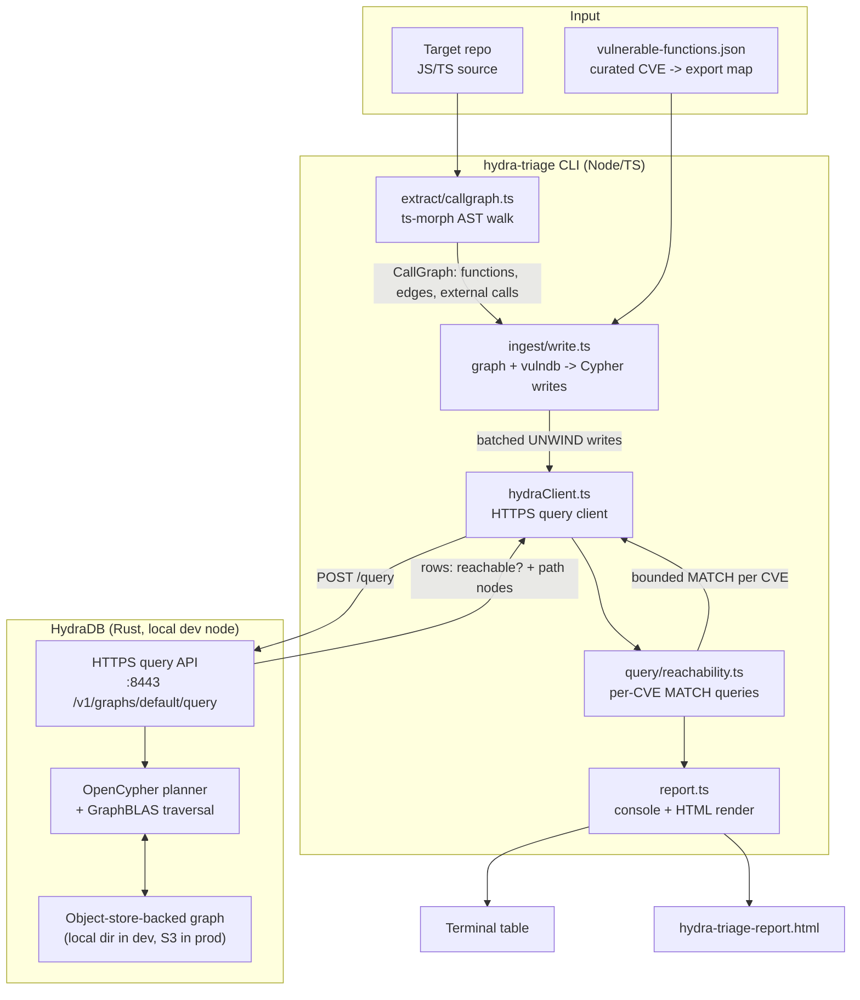
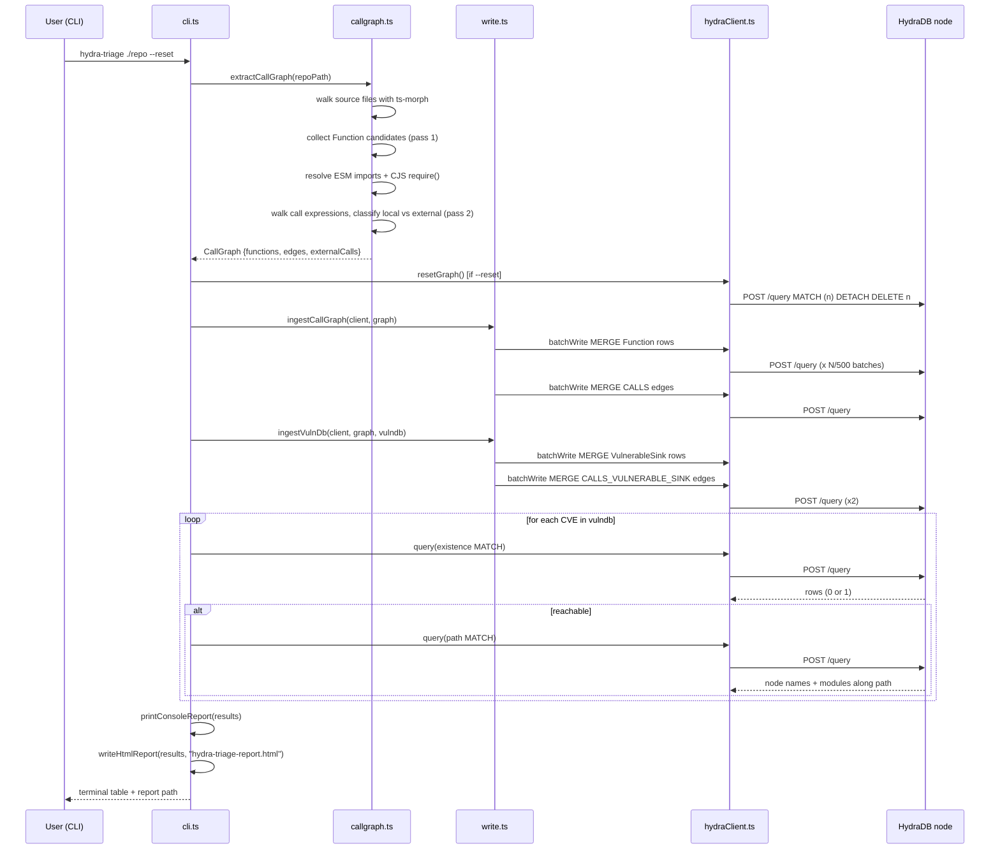

# hydra-triage

**A merge gate, not a report: blocks a PR only if it makes a previously
unreachable CVE reachable — computed as an incremental graph query
against a persistent HydraDB call graph, not a one-shot batch scan.**

> **Start here if you're a judge or short on time:** `npm run gate --
> --repo demo/vulnerable-app --base pre-pr --head pr-482` (§15). Two real
> git commits in this repo simulate an actual pull request — "PR #482:
> restore legacy token support for the mobile client" — that looks
> completely reasonable in a code review and would pass one. The gate
> catches it anyway: that one-line change makes CVE-2022-23529
> (`jsonwebtoken.verify`, a real, cited CVE) newly reachable, and nothing
> else changes. This is the actual product — a CI check with a Slack/PR
> comment integration, live-updating a graph on every commit, using
> HydraDB the way a persistent graph database is meant to be used, not a
> single batch query dressed up as a report. §14 (a real, cited 2018
> supply-chain incident replay) and §1-§13 (the standalone reachability
> engine everything else is built on) are still real and still here, but
> this is the headline.

One sentence version: your SCA tool tells you a vulnerable *package* is in
your tree; hydra-triage tells you whether your code can actually *reach*
the vulnerable *function* — and now, whether a specific pull request is
the thing that made it reachable.

Built for [Hack Hydra](https://hackhydra.hydradb.com/) — Track 02, *Repos,
dependencies and code as graphs*, sub-track A (Supply chain blast radius).

This document is the design spec. It exists so that every line of code
that gets written afterward is answering a question this document already
asked, instead of the other way around. Read this fully before touching
`src/`.

---

## 1. The problem, stated precisely

Software Composition Analysis (SCA) tools — Dependabot, `npm audit`, Snyk,
GitHub's dependency graph — all work the same way underneath: they diff
your `package-lock.json` against a CVE database keyed on `(package,
version range)`. If a vulnerable version is anywhere in your resolved
dependency tree, you get an alert.

This is a *presence* check, not an *exposure* check. It answers "is the
vulnerable code somewhere on disk" when the question that actually
matters is "can an attacker's input reach the vulnerable code path."

The gap between those two questions is enormous in practice. Industry
reachability-analysis vendors (Endor Labs, Socket, Semgrep Supply Chain)
have built entire product lines around the empirical finding that the
large majority of flagged CVEs in a typical dependency tree are never
actually invoked by the code that pulled the package in — the vulnerable
function sits in a transitive dependency's transitive dependency and is
never called, or it's dead code, or it's guarded by a code path the
application never takes.

The cost of this gap is not "some noise." It's the specific, well-known
failure mode of alert fatigue: when 90%+ of alerts are false positives in
the sense of "not exploitable *right now, in this code*," engineers learn
— correctly, rationally — to stop reading them. The one alert in twenty
that was real gets triaged the same way as the nineteen that weren't, and
ships.

### Why this is a graph problem and not a search problem

"Is there a path from any externally-reachable entry point to this
specific function, through this specific chain of local and
cross-package calls" is a transitive closure / bounded-path-existence
question over a directed graph. It has no meaningful embedding — two
functions being "semantically similar" tells you nothing about whether
one calls the other. A vector index cannot answer it at all; you would
have to build a graph traversal on top of the vector store's metadata
anyway, at which point you've built a worse graph database. This is the
exact framing Track 02's brief gives for the whole track, and reachability
is the sharpest, most literal expression of it: the traversal *is* the
product, not a feature bolted onto one.

---

## 2. What "done" looks like — the product, not the prototype

By the Aug 20 submission deadline, "done" means:

1. **A CLI you run against a real cloned repo** (not just the bundled demo
   app) that produces a triage report in under a minute for a
   repo in the low-thousands-of-functions range.
2. **A report that is legible to someone who is not a security engineer**
   — a flat "REACHABLE / not reachable" verdict per CVE, plus the exact
   call chain for reachable ones, rendered both as a colored terminal
   table and a standalone HTML page good enough to screen-record directly
   into the submission video.
3. **A HydraDB graph that is doing real, unique work** — not vendored
   JSON with a graph coat of paint. Specifically: the reachability
   decision must be *computed by HydraDB's query engine* (a bounded
   variable-length `MATCH`), not precomputed in JavaScript and merely
   *stored* in HydraDB. This is the difference between "uses HydraDB" and
   "uses HydraDB meaningfully," which is explicitly a judging criterion
   and explicitly a disqualification risk if failed.
4. **A live, on-camera comparison** against the naive baseline: run
   `npm audit` (or equivalent) on the demo app, show N CVEs flagged; run
   `hydra-triage`, show the same N CVEs with 3 marked reachable, 3 marked
   noise, with the call chain for each of the 3. This is the single
   highest-leverage 30 seconds of the demo video — it's the whole pitch,
   visually, with no narration required.
5. **A public repo with commit history starting on/after Aug 12**, an
   AGPL-3.0 license (matching HydraDB's own), and a README that lets a
   judge who has never seen the project understand what it does and why
   it needed a graph database within two minutes of reading — which is
   this document's job.

### What "done" explicitly does not require

- Multi-language support. JS/TS only, stated as a scoping decision, not
  apologized for.
- A continuously-updated CVE feed. A hand-curated seed database of real,
  well-documented CVEs is the honest scope for nine days — see §8.
- Perfect points-to-precision call graph analysis. Syntactic resolution
  with a documented, deliberate bias toward over-approximating reachable
  edges (safer failure direction for a security tool) is the honest scope
  — see §8.

---

## 3. Standout features — what makes this submission different from
   "another SCA wrapper" or "another graph demo"

These are the things worth saying out loud in the demo video, in order of
how much they differentiate the submission:

**(a) The target node type is the vulnerable *export*, not the vulnerable
*package*.** Most reachability tools that exist commercially work at
package/module granularity. This project models `VulnerableSink` as the
specific function (`ejs.render`, `lodash.template`, `jwt.verify`) an
advisory names as the actual carrier of the vulnerability, sourced from
reading the advisory's technical writeup rather than trusting a
version-range feed. That's a harder, more honest data problem, and it's
the reason the reachability check can be precise instead of "this package
is imported somewhere," which degrades back into the exact noise problem
this tool exists to solve.

**(b) The demo target proves the negative, not just the positive.** It
would be trivial to build a repo where every flagged CVE is reachable —
that doesn't demonstrate anything a `grep` couldn't. `demo/vulnerable-app`
is deliberately built with three CVEs wired to live HTTP routes and three
identical CVEs sitting in genuinely dead code (an unmounted middleware, a
standalone script, an orphaned cache module) using the *same* vulnerable
packages at the *same* flagged versions. The tool has to get the negative
cases right for the demo to mean anything, and it's built to be checkable
by a judge reading the demo app's ~80 lines of source directly.

**(c) The reachability check is one query, not a pipeline of heuristics.**
The entire triage decision is a single bounded variable-length Cypher
`MATCH` HydraDB evaluates natively (§6). There is no separate scoring
model, no LLM call in the hot path, no fuzzy confidence percentage. The
verdict is a graph-theoretic fact — a path exists or it doesn't — which
is a stronger and more defensible claim than "87% confidence this is
exploitable," and it's the kind of claim that's actually true to what a
graph database is for.

**(d) Grounded in real CVEs with real advisory citations, not
invented ones.** Every entry in `vulnerable-functions.json` links to its
GHSA/advisory writeup. A judge can independently verify every claim the
tool makes about what's vulnerable and why, in the same two minutes they
spend reading this README.

**(e) The demo surface makes the traversal itself visible, not just its
verdict.** `public/index.html` (§10.3) renders each reachable finding as
a lane — entry point, every intermediate call, the vulnerable export —
with the connecting path animating in on scan completion. That's not a
dashboard wrapped around the output; it's a direct visualization of the
bounded-path traversal HydraDB just ran. Present-but-unreachable and
never-called CVEs render as a flat, deliberately unanimated list beneath
it, so the visual weight of the page matches the actual finding: three
things happened, everything else is noise, and the eye goes to the three
things without being told to.

---

## 4. System architecture

### 4.1 Component diagram



### 4.2 Component responsibilities, precisely

| Component | Input | Output | What it does NOT do |
|---|---|---|---|
| `extract/callgraph.ts` | Repo path | In-memory `CallGraph` (functions, local call edges, external calls) | Does not talk to HydraDB. Does not know about CVEs. Pure syntax → graph. |
| `vulnerable-functions.json` | (static data) | List of `{cve, packageName, vulnerableExport, severity, summary, reference}` | Does not contain version-matching logic — version ranges are stored as informational metadata only in the MVP (see §8). |
| `ingest/write.ts` | `CallGraph` + vuln entries | HydraDB writes via `HydraClient` | Does not decide reachability. Only creates nodes/edges. |
| `hydraClient.ts` | Cypher strings | Query result rows | Does not know the graph schema. A dumb, schema-agnostic HTTP wrapper. |
| `query/reachability.ts` | Vuln entries + a live `HydraClient` | `ReachabilityResult[]` | Does not touch the filesystem. Does not render anything. |
| `report.ts` | `ReachabilityResult[]` | Terminal output + HTML file | Does not query HydraDB. Pure presentation. |
| `cli.ts` | argv | orchestrates the above in order | The only file that knows the full pipeline shape. |

This separation matters for the demo and for judging: each stage is
independently inspectable. A judge (or you, at 2am before the deadline)
can run the extractor alone and print the `CallGraph` as JSON to sanity
check it before any HydraDB writes happen — this is a debugging
requirement, not a nicety, given the honest limitation in §8 that the
call graph extraction is syntactic and can be wrong in specific,
documented ways.

### 4.3 Why the HTTP query API and not the Bolt driver

HydraDB exposes both. The Bolt interface exists for drop-in compatibility
with existing Neo4j client code and connection pooling in long-lived
services. This project does neither of those things — it's a short-lived
CLI process doing a batch of writes followed by a batch of reads — so the
plain HTTPS JSON API (`POST /v1/graphs/{graph}/query`) is the simpler
correct choice: no driver dependency, no connection lifecycle to manage,
and the request/response shape is directly loggable for debugging, which
matters a lot when the majority of remaining project risk is "did the
Cypher I generated actually do what I think it did."

---

## 5. Data model — the graph schema and why it's shaped this way

```
(:Function {
  id: string,          // "<modulePath>#<name>#<startLine>" — stable, human-readable
  name: string,
  modulePath: string,  // relative to repo root
  startLine: number,
  isEntryPoint: boolean,
  entryKind: "http-route" | "cli-command" | "public-export" | ""
})

(:Function)-[:CALLS]->(:Function)
// local, intra-repo call — the backbone of the traversal

(:VulnerableSink {
  id: string,              // "<packageName>::<vulnerableExport>::<cve>"
  cve: string,
  packageName: string,
  vulnerableExport: string,
  severity: "critical" | "high" | "medium" | "low",
  summary: string,
  reference: string        // advisory URL
})

(:Function)-[:CALLS_VULNERABLE_SINK]->(:VulnerableSink)
// created only when a function's external call matches a known
// (packageName, vulnerableExport) pair from the vuln database
```

### 5.1 Why `VulnerableSink` is a node and not an edge property

The alternative design — tagging the `CALLS_EXTERNAL` edge itself with
`importedName` and filtering on that property during traversal — was
considered and rejected. Two reasons:

1. **Query simplicity.** With `VulnerableSink` as its own labeled node,
   "is X reachable" becomes a single pattern match ending in a node label,
   which is the most basic and most reliably-supported shape of query in
   any Cypher-family engine. Filtering on an edge property *mid-traversal*
   inside a variable-length path (`[:CALLS_EXTERNAL*]` with a property
   predicate on the *last* hop specifically, not all hops) is a fussier
   query to get right, and this project would rather spend its query
   budget on being certain the core check is correct than on being clever.
2. **It's the more honest graph model anyway.** A vulnerability is a real
   entity with its own attributes (severity, advisory reference, summary)
   that don't belong on a call edge. Modeling it as a node is not a
   workaround, it's the correct ontology.

### 5.2 Why entry points are a boolean property, not a separate label

`isEntryPoint` could have been its own `:EntryPoint` label. It's a
property instead because entry-point-ness is genuinely a property of a
`Function`, not a different kind of thing — the same node needs to be
matchable as "a Function with this name/module" in some queries and "an
entry point" in others, and a property predicate composes into both
without needing two labels kept in sync.

### 5.3 What the schema deliberately leaves out (v1)

- **No `Package` node for every dependency**, only for ones with a known
  vulnerable export. A full package graph (every `require`/`import`
  target as a node) was cut because it adds ingestion cost and query
  surface without changing the reachability answer — it's a natural v2
  extension once the vuln database is fed from a real CVE source instead
  of hand-curated (see §8), at which point "which packages does this repo
  depend on, transitively" becomes its own useful query.
- **No version nodes / semver range matching in the graph.** `affectedVersions`
  is stored as metadata on the JSON entry, not enforced. The MVP assumes
  the demo target's `package.json` is already known to pin the flagged
  version; a real deployment would resolve the installed version first
  and only ingest `VulnerableSink`s whose range actually matches, which is
  ordinary semver logic in the ingestion step, not a graph problem.

---

## 6. The reachability query — the actual product, in detail

For every entry in the vuln database, two queries run:

**Existence check** (cheap, run first, per §7.2 for why this ordering
matters):

```cypher
MATCH (e:Function {isEntryPoint: true})-[:CALLS*0..8]->(f:Function)
      -[:CALLS_VULNERABLE_SINK]->(v:VulnerableSink {id: "<sinkId>"})
RETURN e.id AS entryId, e.name AS entryName, f.id AS callerId
LIMIT 1
```

**Path materialization** (only run for CVEs the existence check found
reachable, to build the human-readable chain for the report):

```cypher
MATCH p = (e:Function {isEntryPoint: true})-[:CALLS*0..8]->(f:Function)
          -[:CALLS_VULNERABLE_SINK]->(v:VulnerableSink {id: "<sinkId>"})
RETURN [n IN nodes(p) | n.name] AS names,
       [n IN nodes(p) | n.modulePath] AS modules
LIMIT 1
```

### 6.1 Why `0..8` and not unbounded

HydraDB's OpenCypher subset supports *bounded* variable-length paths as a
first-class, indexed-traversal-friendly operation — unbounded traversal
on a general graph is the textbook way to accidentally ask for a
combinatorial explosion. 8 hops is a judgment call: deep enough to cover
realistic call chains from an HTTP handler through a couple of service
layers into a utility function, shallow enough to keep the query cheap at
demo scale. It's a CLI flag waiting to happen (`--max-hops`), not
hardcoded out of laziness — deliberately not exposed yet because nothing
in the demo needs it, and an unused flag is worse than no flag.

### 6.2 Why one query per CVE instead of one batched query for all of them

This is a real, acknowledged tradeoff, not an oversight. HydraDB's native
`algo.MSpaths` procedure is built exactly for "many sources, many
targets, one traversal call" — see the upstream README's own example,
which batches multiple `sourceValues` against multiple `targetValues` in
a single `CALL`. The blocker is that the documented example matches
source and target against the *same* indexed label/property
(`sourceLabel: 'Entity'`), and this project's source (`Function.id`) and
target (`VulnerableSink.id`) are different labels entirely. Nothing in
the public docs confirms `MSpaths` supports cross-label source/target
matching. Guessing at an undocumented parameter shape and shipping a
query that might silently return wrong results felt like a worse risk
than N round trips of a query that is unambiguously correct — at the
demo's scale (single-digit entry points, single-digit CVEs) the
performance difference is invisible anyway. This is flagged as the first
thing to raise in the Hack Hydra Discord: if `algo.MSpaths` does support
cross-label targeting, that's a straightforward swap that would matter a
lot past hackathon scale, and would be a stronger "Best Use of HydraDB"
argument than the current plain-`MATCH` approach.

---

## 7. End-to-end interaction sequence

What actually happens, in order, when someone runs
`hydra-triage ./some-repo --reset`:



### 7.1 Failure modes this sequence has to handle gracefully

- **HydraDB node not running / wrong port** — `hydraClient.query` throws
  with the HTTP status and response body inlined into the error, plus the
  exact Cypher that was sent, so the first debugging step is always
  visible in the error message itself rather than requiring a second run
  with `--verbose`.
- **Zero entry points found** — **fixed.** `cli.ts` checks the entry-point
  count straight after extraction and prints an explicit warning
  ("results are inconclusive, not clean") before ingestion even starts,
  rather than silently producing a report that looks like a clean bill of
  health for the wrong reason.
- **A CVE in the vuln db for a package the repo doesn't use at all** —
  **fixed.** `ingestVulnDb` now returns the set of `VulnerableSink` ids
  that received at least one real `CALLS_VULNERABLE_SINK` edge during
  ingestion. `checkReachability` uses that set to short-circuit: a CVE
  with no edge at all is reported as `not-present` without ever querying
  HydraDB for it, and is rendered as its own category — distinct from
  `present-unreachable` (called somewhere, but no path from an entry
  point) — in both the terminal table and the HTML report. Those are
  different findings for a triager and now read as different findings.

### 7.2 Why the existence check runs before the path query, as two separate round trips

An earlier draft of this design ran the path-materializing query for
every CVE unconditionally and treated an empty result as "not reachable."
That's correct but wasteful: `LIMIT 1` on the existence check lets HydraDB
stop traversing the instant it finds any satisfying path, while the path
query's node-list projection does more work per matched row. Splitting
them means the common case (a CVE that turns out unreachable) pays only
for the cheap query. At data-file-of-six-CVEs scale this is invisible;
it's documented here because it's the kind of decision that stops being
invisible the moment the vuln database stops being a hand-curated file
of six entries (§8), and the query design should already assume that
future without needing to be rewritten for it.

---

## 8. Honest limitations — read this before the demo, not after a judge finds it

Stated up front, in the tool's own README, on purpose: a judge who finds
an unstated limitation independently reads it as a gap in rigor; a judge
who finds it stated plainly reads it as competence. Every limitation below
is a *scoping decision* with a stated reason, not an apology.

1. **Vulnerable-function database is hand-curated (six entries), not fed
   from a live CVE source.** Function-level "which export actually
   carries this vulnerability" data barely exists in structured form
   across OSV/GHSA/NVD — those feeds are package-and-version granular.
   Building that mapping at scale is a real, separately hard data
   engineering problem (arguably a hackathon project on its own), and
   faking scale with unverified entries would be worse than a small,
   individually-verified set. Every entry links to its source advisory.
2. **Call graph extraction is syntactic (identifier/property-name
   matching), not type-resolved.** Consequence: same-named local and
   imported symbols are disambiguated by import-map lookup order rather
   than verified type binding, and cross-file same-name collisions (two
   files each declaring a function called `handler`, say) resolve to
   whichever declaration was indexed first. **Fixed:** an earlier draft
   also over-attributed calls made inside a nested closure to every
   enclosing named function, not just its true immediate parent — each
   call site is now walked up to its single nearest function-like
   ancestor (`nearestEnclosingFunctionId` in `extract/callgraph.ts`)
   instead of re-scanning every tracked function's entire body subtree,
   which also made extraction O(calls) instead of O(functions × body
   size). The remaining imprecision (name-collision disambiguation) is
   inherent to a syntactic, non-type-resolved extractor and still biases
   toward over-reporting reachability rather than under-reporting it —
   the safer failure direction for a security tool, but not
   interprocedurally precise the way a full points-to analysis would be.
3. **JS/TS only.** A language-agnostic version would need a
   per-language extractor behind the same `CallGraph` interface — the
   schema and query layer don't change, only `extract/callgraph.ts`'s
   replacement would.
4. **Semver ranges are metadata, not enforced.** See §5.3.
5. **`algo.MSpaths`/`algo.SPpaths` native path procedures are not used
   for the core check** — see §6.2 for the specific reason and the
   specific follow-up question for the HydraDB team.
None of these are blockers for a working, honest, judgeable submission.
They are the explicit list of "what we'd build next," which is a stronger
thing to hand a judge than a README that implies the tool is more finished
than it is.

---

## 9. Repository layout

```
src/
  types.ts               shared TypeScript interfaces for every stage
  extract/callgraph.ts   ts-morph call graph extraction (ESM + CJS require())
  vulndb/vulnerable-functions.json   curated real-CVE -> vulnerable-export database
  cypherLiteral.ts         renders JS values as real Cypher literals (map keys are bare identifiers, not JSON)
  hydraClient.ts          HydraDB HTTPS query client
  ingest/write.ts          CallGraph + vulndb -> HydraDB writes (also returns which sinks are actually called)
  query/reachability.ts    the reachability queries (section 6)
  report.ts                console table + standalone HTML report
  cli.ts                   CLI entry point, orchestrates the pipeline (section 7)
  webServer.ts             HTTP wrapper around the identical pipeline, for the browser client
  incidentCli.ts           runs the real event-stream/flatmap-stream incident replay (section 14)
  incident/event-stream-2018.json   real, cited incident data + timeline + sources
  incident/ingest.ts        loads the incident graph (Version/Consumer/DEPENDS_ON/RESOLVED)
  incident/query.ts         the exposure vs. actually-targeted query pair (section 14.3)
  gate.ts                   pure delta logic: base scan + head scan -> newly-reachable CVEs (section 15)
  gateCli.ts                the PR gate CLI — git worktree + the standard pipeline, run twice, diffed
src/config.ts             shared HydraDB connection config (baseUrl/token/etc.), one source of truth
src/safeStatic.ts          path-containment check for serving client/dist/, self-tested against traversal payloads
client/                    React + TypeScript + Vite web client (section 10.6) — separate npm project
  src/App.tsx               owns scan state and tab switching
  src/components/           TopBar, StatRail, TraceView, IssuesTable
  src/issuesLogic.ts         pure filter/sort logic for the Issues tab, self-tested independent of React
.github/workflows/hydra-triage-gate.yml   real GitHub Actions PR check wiring gateCli.ts in
demo/vulnerable-app/       synthetic scan target — 3 reachable CVEs, 3 dead-code CVEs
scripts/setup-hydradb.sh   local HydraDB bring-up, copied from upstream README
```

## 10. Setup

### 10.1 Run HydraDB locally

From a checkout of [hydra-db/hydradb](https://github.com/hydra-db/hydradb):

```bash
bash /path/to/hydra-triage/scripts/setup-hydradb.sh
```

Mirrors the upstream README's local dev-node instructions: plaintext HTTP
on `:8443`, Bolt on `:7687`, admin/metrics on `:9090`.

### 10.2 Install dependencies

```bash
npm install
```

### 10.3 Run the headline demo — the real incident replay

```bash
npm run incident
```

See §14 for what this actually reproduces and why it exists. This is the
first thing to run against a live HydraDB node, not the CLI or the
browser client — it's the strongest evidence in the whole submission and
takes about ten seconds once HydraDB is up.

### 10.4 Or run the CLI against arbitrary repos

```bash
npm run scan -- ./demo/vulnerable-app --reset
```

Flags: `--base-url`, `--token`, `--namespace`, `--graph`, `--cell` for a
non-default HydraDB target; `--vulndb <path>` to point at a different
vulnerable-function database; `--out <path>` for the HTML report
location.

### 10.5 Run the PR gate — the actual headline (§15)

```bash
npm run gate -- --repo demo/vulnerable-app --base pre-pr --head pr-482
```

Two real git commits in `demo/vulnerable-app` simulate an actual pull
request. See §15 for what this proves and why it's the strongest thing
in this submission.

### 10.6 Or run the browser client

**This is a real React + TypeScript app now (Vite-built), not a hand-written
HTML file with string-concatenated markup and vanilla DOM manipulation —
that was the previous version, and it's gone.** Lives in `client/`, is a
fully separate npm project from the root, and talks to `webServer.ts`
purely over HTTP (`POST /api/scan`), so neither side needs to know
anything about the other's internals.

```bash
npm run client:install   # first time only
npm run client:build     # emits client/dist/
npm run web              # serves client/dist/ + the /api/scan endpoint on :5173
```

Or for local development with hot reload — two terminals:

```bash
npm run web           # terminal 1: the API on :5173
npm run client:dev     # terminal 2: Vite dev server on :5174, proxies /api to :5173
```

Structure: `App.tsx` owns scan state and tab switching; `TopBar.tsx`,
`StatRail.tsx`, `TraceView.tsx`, and `IssuesTable.tsx` are the four real
components, each owning only its own presentation. Type a repo path
(defaults to `./demo/vulnerable-app`), hit **Scan**. The API server runs
the *exact same pipeline* `cli.ts` does — `extractCallGraph` →
`ingestCallGraph` → `ingestVulnDb` → `checkReachability` — and returns it
as JSON; no duplicated logic lives in the server, so the CLI and the
browser client can never silently disagree with each other.

**What the Trace tab is actually showing, and why it's built this way:**
every `reachable` CVE renders as its own horizontal lane — entry point on
the left, the vulnerable package export on the right, every intermediate
function call in between — and the connecting edges animate in
sequentially on scan completion (`TraceView.tsx`'s one `useEffect`,
staggering a `traced` class onto each lane). That animation is not
decoration; it's the literal graph traversal HydraDB just computed, made
visible. Everything that's merely *present* (called somewhere, no path
from an entry point) or *not called at all* renders as a flat,
deliberately unanimated list below it.

**Second tab: All Issues.** The trace view is built for the demo moment —
it's not how anyone would triage a real backlog of findings day to day.
The Issues tab is a plain filterable, sortable table of every CVE the
scan produced: search by CVE/package/export, filter by severity or
status, click a column header to sort, click a row to expand it into the
full call chain, CVE summary, and a link to the real advisory. **All of
that logic lives in `client/src/issuesLogic.ts`, deliberately kept free
of React and the DOM** — `IssuesTable.tsx` just calls
`filterAndSortIssues()` and renders whatever comes back. That's what
makes it the one part of the React app actually self-tested in this
sandbox: `client/.selftest/run-issues-logic.mjs`, 11/11 assertions,
covering filtering, searching, sorting (including a stable-sort check),
and — the specific thing a naive implementation gets wrong — confirming
the input array is never mutated.

`summary`/`reference` reaching the UI at all required a real fix, not
just a rendering choice: an earlier version of `ReachabilityResult`
computed both during ingestion and then dropped them before the report,
so there was no advisory link or CVE description anywhere downstream.
Fixed in `query/reachability.ts`; both this client and the standalone CLI
HTML report (§10.4) carry it now.

**A real security bug got caught and fixed building this, twice.** The
first version of `webServer.ts`'s static file server used
`filePath.startsWith(publicDir)` to check containment — a well-known
broken pattern (a request resolving to `/public-evil/x` passes a
`startsWith("/public")` check). That got "fixed" by removing static
serving capability entirely, since the app had exactly one file to serve
at the time. Vite's build emits hashed asset filenames
(`assets/index-a1b2c3.js`), so single-file serving doesn't work anymore —
generic static serving came back, and this time the containment check
(`src/safeStatic.ts`) is self-tested against real traversal payloads,
including the exact sibling-directory-prefix case that would have
exploited the original bug (`.selftest/run-safe-static.mjs`, 8/8 passing).

Config via env vars: `HYDRA_BASE_URL`, `HYDRA_TOKEN`, `HYDRA_NAMESPACE`,
`HYDRA_GRAPH`, `HYDRA_CELL`, `PORT` (default `5173`).

**Honest status:** `safeStatic.ts`, `webServer.ts`'s non-JSX logic, and
`client/src/issuesLogic.ts` are parse-checked and/or self-tested as
described above. The React components themselves (`.tsx` files) are
**not** — Node's native type-stripping explicitly does not support JSX
(it's not erasable-only syntax, it needs real codegen), so there's no
equivalent of the parse-check I could run on `TraceView.tsx`,
`IssuesTable.tsx`, `App.tsx`, or `TopBar.tsx` in this sandbox. They were
written carefully and reviewed by eye, same as `callgraph.ts` was before
its bugs got fixed — but "reviewed by eye" is a materially weaker claim
than tested, and I want that boundary stated plainly rather than implied
away by how finished the rest of this section reads. First real render
belongs in the RUNBOOK, as its own checkpoint.

## 11. Self-test — validating the core logic without HydraDB or `npm install`

```bash
npm run selftest
```

This does not touch HydraDB at all. `.selftest/build.mjs` uses Node's
native `stripTypeScriptTypes` (no `tsc`, no dependencies) to strip types
from the five modules that have zero external imports — `cypherLiteral.ts`,
`types.ts`, `hydraClient.ts`, `ingest/write.ts`, `query/reachability.ts` —
which together are the entire ingestion and reachability decision logic,
just not the ts-morph-based extractor or the CLI/report presentation
layer. `.selftest/run.mjs` then runs that real code against
`.selftest/fakeHydraDB.mjs`, a purpose-built in-memory stand-in that:

- parses the actual Cypher list-of-maps literal text `cypherLiteral.ts`
  produces (a real parser, not a mock — this is what caught the
  JSON.stringify bug described in §6's history), and
- answers the bounded-path reachability queries with real BFS over an
  in-memory adjacency structure, matched against the exact query shapes
  `query/reachability.ts` generates.

`run.mjs`'s fixture mirrors `demo/vulnerable-app`'s intended shape (3
reachable CVEs, 3 present-but-unreachable, 1 not-present at all) and
asserts every one of the 7 classifications is correct. This is real
end-to-end validation of the ingest → reachability pipeline; it exists
because this project was built in a sandbox with no network access to run
an actual HydraDB node against, and "wrote code that was never executed"
is a materially weaker claim than "wrote code and proved the core logic
correct against a faithful stand-in." It is not a substitute for running
against the real HydraDB binary — the extractor (ts-morph AST walking)
and the actual OpenCypher engine's query-planning behavior are both
untested by it — but it de-risks the part of the system most likely to
have silent logic bugs.

`npm run selftest` also runs `.selftest/run-incident.mjs` (§14 — the real
event-stream incident, 6/6 assertions) and `.selftest/run-gate.mjs` (§15
— the PR-gate delta logic, 10/10 assertions, including the exact scenario
`pre-pr` → `pr-482` produces). Total: 23 assertions across three modules,
all passing, all against real shipped code, none against a hardcoded
duplicate of anything — see §15.4 for what that leaves genuinely untested.

## 12. License and attribution

AGPL-3.0, matching HydraDB's own license — see `LICENSE`.

- [HydraDB](https://github.com/hydra-db/hydradb) — the graph database this
  project is built on; the reachability query in §6 is the load-bearing
  use of it.
- [ts-morph](https://github.com/dsherret/ts-morph) — TypeScript/JS AST
  access for the call graph extractor.
- Every CVE in `src/vulndb/vulnerable-functions.json` links to its public
  advisory (GitHub Security Advisory / original technical writeup) as its
  `reference` field.

## 13. Runtime portability note

`hydraClient.ts` deliberately avoids TypeScript constructor-parameter-property
sugar (`constructor(private x: T) {}`). Node's native type-stripping
(`node --experimental-strip-types`, and the mode `tsx` uses) only supports
that syntax in full "transform" mode, not the faster "strip-only" mode —
plain field declarations run under both. Worth keeping in mind project-wide:
this codebase should stay runnable with bare Node's type stripping, not just
through a full `tsc`/`tsx` pipeline, since that's a meaningfully lower-friction
path for anyone (a judge included) trying to run it without `npm install`
succeeding first.

## 14. The headline demo — event-stream / flatmap-stream / Copay, 2018

Everything above this section describes a general-purpose tool. This
section describes the specific, real, cited incident it's built to
demonstrate — because a generic "we do reachability analysis" pitch is
not novel (Endor Labs, Socket, and Semgrep Supply Chain all sell exactly
that commercially), and this hackathon's own brief specifically calls out
supply-chain worm scenarios as the sharpest expression of Track 02. This
is that scenario, reproduced against real facts instead of invented ones.

### 14.1 What actually happened, sourced

Every claim below is drawn from live web search against primary and
near-primary sources — npm's own incident postmortem, Snyk's technical
writeup, the original GitHub issue thread, and an academic case-study
paper — not reconstructed from training-data memory. Full source list and
per-fact provenance notes live in `src/incident/event-stream-2018.json`.

- `event-stream`, maintained by Dominic Tarr, was a hugely popular utility
  library (~2M downloads/week). In September 2018, Tarr — no longer
  actively maintaining it — handed publish rights to a volunteer,
  `right9ctrl`, who had spent weeks building trust with small, benign
  commits.
- On **September 9, 2018**, `right9ctrl` added a new dependency,
  `flatmap-stream` (range `^0.1.0`), and published `event-stream@3.3.6`.
  `flatmap-stream@0.1.1` (and `0.1.2`) contained obfuscated, encrypted
  malicious code hidden in the published tarball's test directory —
  invisible on GitHub, only present in the npm package itself.
- On **September 16**, `right9ctrl` removed the `flatmap-stream`
  dependency and inlined the function directly, shipping a clean
  `event-stream@4.0.0` — but `3.3.6` remained the latest `3.x` tag and
  stayed installable for over two months.
- The payload sat inert for almost everyone who installed it. It only
  activated when `process.env.npm_package_description` — set by npm from
  the *root* package being built — matched **`"A Secure Bitcoin Wallet"`**
  exactly: the literal `package.json` description of **Copay**, BitPay's
  Bitcoin wallet app. Everyone else got a failed decryption and silent
  no-op.
- Discovered publicly **November 19-20, 2018**; npm Security pulled both
  packages **November 26, 2018**. Copay versions 5.0.2–5.1.0 shipped with
  the compromised build.

**The one detail that makes this a graph-and-property-filter story, not
just a graph story:** reachability alone — "who has the malicious code
somewhere in their resolved dependency tree" — was true for roughly
everyone who installed `event-stream` during that window. The thing that
actually decided who got harmed was a single property equality check on
the *consuming* application, evaluated at build time. A pure
package-presence scanner sees the first fact and stops. A graph database
with property predicates sees both — and that's the entire reason this
needed HydraDB's query engine and not a lookup table.

### 14.2 Graph model

```
(:Version {id: "<pkg>@<ver>", package, version, malicious})
(:Version)-[:DEPENDS_ON {range}]->(:Version)
(:Consumer {id, name, vendor, packageDescription, isSynthetic})
(:Consumer)-[:RESOLVED]->(:Version)
```

`isSynthetic` exists because the real, documented incident has exactly
one named target (Copay). To make the "many exposed, one targeted"
contrast visible with more than a single data point, `src/incident/ingest.ts`
adds three clearly-labeled illustrative decoy consumers — `(illustrative)
internal-analytics-dashboard`, etc. — that resolve the *same* compromised
`event-stream@3.3.6` but carry a different, harmless `packageDescription`.
Every decoy is flagged `isSynthetic: true` in the graph itself and in
every place the tool renders it; none is ever presented as a real project,
and the real incident's facts (§14.1) don't depend on them at all — they
exist purely to make the property-filter's selectivity demonstrable.

### 14.3 The two queries, in order

```cypher
-- Query 1: exposure. What a generic blast-radius tool stops at.
MATCH (c:Consumer)-[:RESOLVED]->(v1:Version)-[:DEPENDS_ON*0..4]->(v2:Version {malicious: true})
RETURN DISTINCT c.id, c.isSynthetic, c.packageDescription
```

```cypher
-- Query 2: actually targeted. The same traversal, plus the one property
-- predicate that mattered in reality.
MATCH (c:Consumer {packageDescription: "A Secure Bitcoin Wallet"})-[:RESOLVED]->(v1:Version)
      -[:DEPENDS_ON*0..4]->(v2:Version {malicious: true})
RETURN DISTINCT c.id, c.isSynthetic, c.packageDescription
```

Against the ingested graph (real target + 3 decoys), query 1 returns 4,
query 2 returns 1 — and it's the real one, not a decoy. See
`.selftest/run-incident.mjs` for the executable proof of that, not just
the assertion.

### 14.4 Running it

```bash
npm run incident
```

Runs against the same local HydraDB node as everything else (§10.1),
using `HYDRA_BASE_URL`/`HYDRA_TOKEN`/etc. env vars if you're not on
defaults. Prints both query results and the exposed-vs-targeted contrast.
**Honest status:** parse-checked and self-tested (§11) against a faithful
in-memory stand-in — `.selftest/run-incident.mjs` passes all 6 assertions
— but like everything else that touches `ts-morph` or a real HydraDB
socket, it has never executed against the real binary. See `RUNBOOK.md`
step 2.5 for exactly what to check first.

### 14.5 What this section is not claiming

- **Not claiming to have crawled the real 2018 npm dependency graph at
  scale.** "Thousands of downstream projects were exposed" is the
  widely-reported scale of the real incident (cited in
  `event-stream-2018.json`'s `reportedScale` field), but enumerating the
  actual full list of real projects that resolved the compromised version
  would require either npm's own (unofficial, UI-only) dependents feature
  or a third-party index like libraries.io — neither reachable from this
  sandbox. The three decoy consumers are explicitly synthetic stand-ins
  for that missing breadth, not a claim of having sourced it.
- **Not claiming `bitcore-wallet-client` or any other specific
  intermediate package sat between Copay and `event-stream`.** Sources
  describe the activation mechanism precisely (the `npm_package_description`
  environment-variable check) but don't specify the exact intermediate
  dependency chain from Copay's package.json down to `event-stream`, so
  none is invented here — `Consumer -[:RESOLVED]-> Version` models "this
  consumer's build resolved this compromised version," which is accurate
  to what's documented, without asserting an unverified path.

## 15. The PR gate — why this is the actual product

Everything in §1-§14 computes reachability once, as a batch. That's a
useful tool, but it's also the exact shape of every commercial
reachability-analysis product (Endor Labs, Socket, Semgrep Supply Chain)
— a report you read after the fact. This section is the part that isn't
that: a check that runs on every pull request, keeps a persistent graph
that gets incrementally updated commit by commit, and blocks a merge
based on a **delta** query — "did *this specific change* make something
newly reachable" — not a snapshot.

### 15.1 Why this is a stronger use of HydraDB than a batch scan

A one-shot scan could be done by any embedded graph library — the
persistence barely matters if you throw the graph away after one query.
A PR gate is different: the graph needs to *exist between runs*, get
updated incrementally as commits land, and answer "what changed" queries
against accumulated history. That's an actual argument for a persistent
graph database's storage model, not just its query language — closer to
what HydraDB's own pitch (object-storage-backed, built for agents and
context that persists) is for, instead of using it as a fancy way to run
one `MATCH` and throw the result away.

### 15.2 The demo — two real git commits, not a hypothetical

`demo/vulnerable-app` is now its own git repo with two tagged commits:

- **`pre-pr`** — the app as already described in §10.4: three CVEs
  reachable, three sitting in genuinely dead code.
- **`pr-482`** — one commit later. It adds a single line —
  `app.use(legacyAuthMiddleware)` — under the commit message *"PR #482:
  restore legacy token support for the mobile client during the auth
  migration."* That message is deliberately the kind of thing that sails
  through code review: specific, plausible, boring. It's also exactly the
  commit that wires `jsonwebtoken.verify` (CVE-2022-23529) into a live
  request path for the first time.

```bash
npm run gate -- --repo demo/vulnerable-app --base pre-pr --head pr-482
```

**Expected: the gate reports exactly one newly reachable CVE
(CVE-2022-23529), zero newly-clear, and exits non-zero** — everything
else about the app is unchanged between the two commits, and the gate
says so explicitly rather than re-flagging the three CVEs that were
already reachable before this "PR." That's the whole pitch: a PR that
looks completely fine gets blocked for the one real reason, with the
exact call chain, and nothing else about it gets treated as this
change's fault.

### 15.3 How it works

`src/gateCli.ts` uses real `git worktree add --detach <tmpdir> <ref>` to
check out both refs to disk — not a diff parser, the actual files at that
ref — and runs the *exact same* `extractCallGraph` → `ingestCallGraph` →
`ingestVulnDb` → `checkReachability` pipeline from §7 against each,
resetting the graph between them. `src/gate.ts` (pure, dependency-free —
see §11 for why that matters for testing) then computes the delta:

```ts
if (baseStatus !== "reachable" && headStatus === "reachable") {
  newlyReachable.push(entry); // this is the only thing that blocks the PR
} else if (baseStatus === "reachable" && headStatus !== "reachable") {
  newlyClear.push(entry); // a PR that fixes something, reported, not gated
}
```

`.github/workflows/hydra-triage-gate.yml` wires this into an actual
GitHub Actions PR check with a Markdown PR comment. **Honest gap, stated
directly instead of hidden:** it references a HydraDB service container
image I could not verify exists — I searched for one and found nothing
real (every public Docker image called "hydra" is an unrelated project:
a Postgres extension, an NZB search tool, an OAuth2 server). The workflow
is written to point `HYDRA_BASE_URL` at wherever a real instance actually
runs instead of asserting a container path I couldn't check.

### 15.4 What's tested vs. not

`git worktree` mechanics — the actual thing `gateCli.ts` depends on that
isn't covered by the ts-morph/HydraDB self-test gap elsewhere — **was
verified directly** against the real `pre-pr`/`pr-482` commits: `grep -c
legacyAuthMiddleware` on each checked-out worktree returns `0` and `2`
respectively, proving the two refs actually differ the way the demo
claims. `src/gate.ts`'s delta logic has its own self-test
(`.selftest/run-gate.mjs`, 10/10 passing) covering the real demo scenario
plus fix-only, no-op, and new-CVE-at-head cases. What's *not* tested:
`gateCli.ts` itself end-to-end, since that requires `ts-morph` and a live
HydraDB socket — same boundary as everything else in this project that
touches either.


